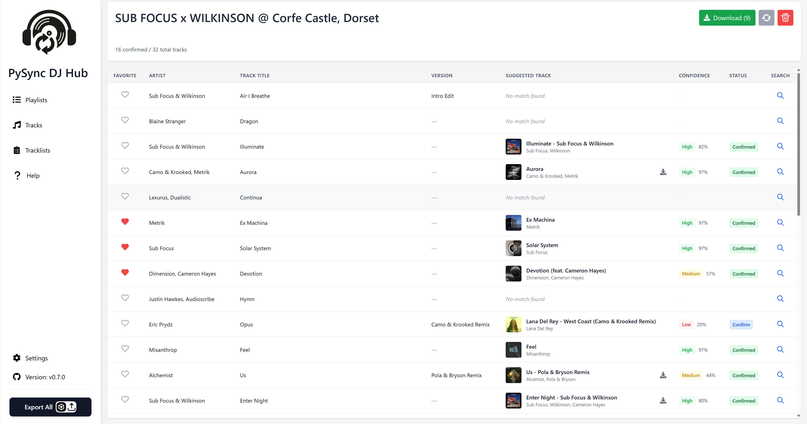

# Tracklists Guide

Tracklists let you import a DJ set tracklist, auto-match each entry to tracks in your library, then confirm. Also quickly and easily find and download tracks not already in your library.

<div align="center">
    
</div>

## What You Can Do

- Import a raw text tracklist and process it into saved tracklists ready for playing.
- Auto-predict matches from your library with ai algorithm.
- Manually search and override any entry.
- Confirm/unconfirm and favourite entries.
- Refresh predictions for unconfirmed entries.
- Download confirmed tracks that are not already downloaded.

## How To Use

1. Open **Set Tracklists** from the sidebar.
2. Click **Add Tracklist**.
3. Provide:
   - `Set Name`
   - `Tracklist String` (one track per line)
4. Save and wait for predictions to complete.
5. Open the created tracklist:
   - Review suggested track + confidence
   - Click **Confirm** for correct matches
   - Use search icon to find a better match if needed
   - Optionally mark favourites
6. Click **Download** to download confirmed tracks.

## Expected Tracklist Input

Typical formats:

```text
0:12 Sub Focus - Ecuador
1:50 - Marlon Hoffstadt - It's That Time (Dimension Remix)
45:57 Fred again.., Skepta, PlaqueBoyMax - Victory Lap (Sudley Bootleg)
•	00:10 - Avicii - Levels (1991 Remix)
1. Sub Focus & Dimension - Desire w/ Subsonic - Ascend
```

Best results are achieved when each line contains a single artist and title.

